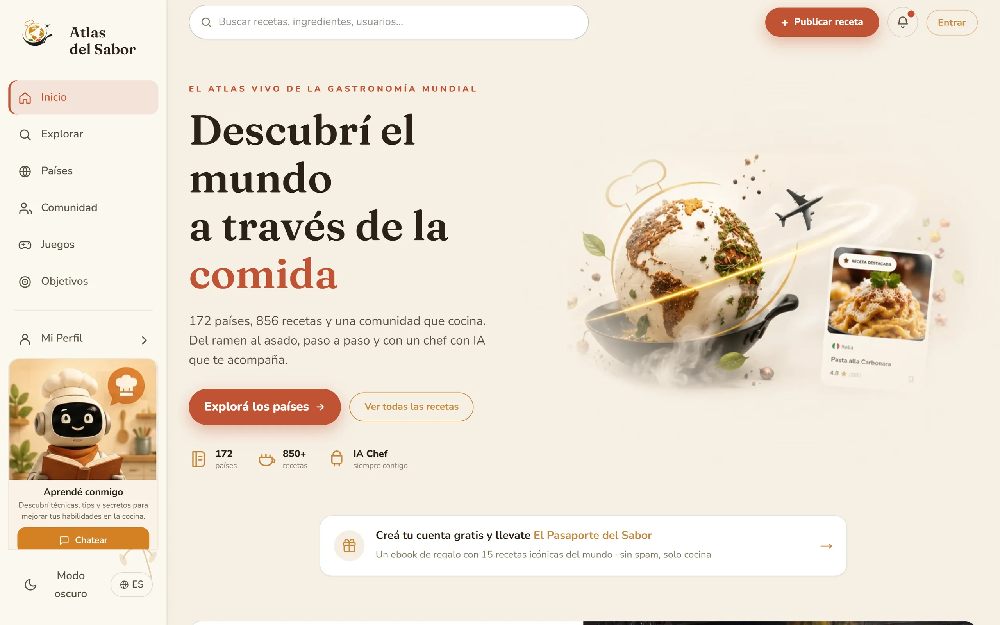

# Atlas del Sabor

**A culinary atlas of 172 countries, with an AI chef that answers while you cook and a camera that turns a photo of a dish into a recipe.**

  
  
  

Llama 3.3 70B · Llama 3.1 8B · vision model · served through Groq

## What it is

Traditional recipes from around the world, with their history and technique, a chef you can ask questions to, and a photo camera that drafts recipes from dishes.

## Why it exists

I wanted well-explained traditional recipes from everywhere, and someone to ask while cooking. Writing 856 recipes by hand wasn't realistic, and letting AI choose what to publish wasn't reliable.

## How I solved it

The AI does the heavy lifting but doesn't decide what matters. A hand-curated list fixes which dishes go in. The model writes each recipe. What users upload goes through a review before it's published.

## How the AI is used

**The model does:**
- Writes each recipe from a dish fixed by the canon.
- The chef answers in live chat. It knows which country and recipe you're looking at and replies in your language.
- A vision model drafts a recipe from a photo of a dish: name, ingredients, steps and times.
- Translates recipes when someone asks for another language.

**The code controls:**
- The canon defines the 5 dishes for each country. The AI never picks dishes.
- Generation is incremental: if it stops at the daily limit, it resumes where it left off.
- Every AI route validates input with Zod and has rate limiting with Upstash Redis.
- The vision feature has a quota of 6 photos per hour. Translations are cached for a week.
- If a model is retired, the call moves to the next one automatically.

**A person decides:**
- The dish canon was verified by hand, country by country.
- A recipe drafted from a photo is only a draft: a person corrects it before publishing.

## Flow

1. **Canon:** 5 dishes per country, verified by hand.
2. **Generation:** Groq writes each recipe in the canon.
3. **Chef Atlas:** live chat with the context of the page.
4. **Recipe from a photo:** the vision model drafts it.
5. **Review:** a person corrects and publishes.

## Design decisions

- **The AI writes, it doesn't choose.** Picking a country's dishes is a cultural decision, so it stays in a hand-made list.
- **Its own provider layer.** Everything goes through an internal AI service. Switching from Groq to another provider means changing an environment variable.
- **Quotas based on cost.** Vision costs more than text, so it has its own quota. Translations are cached so they're never paid for twice.

## Stack

Next.js · TypeScript · Tailwind CSS · Supabase · Groq · Zod · Upstash Redis · Vercel

## Numbers

- 172 countries
- 856 traditional recipes
- About 1,100 static pages

---

The source code is private. This repository explains how the project works, not its code.
Portfolio: https://ignaciomoralesdev.vercel.app
